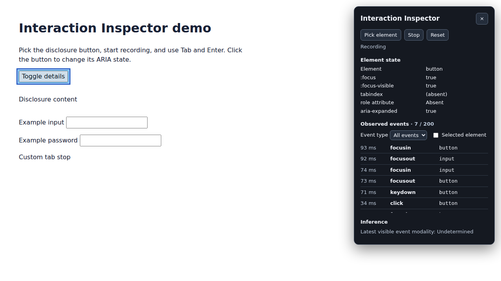

# Interaction Inspector

**English** · [한국어](docs/ko/README.md) · [日本語](docs/ja/README.md) · [简体中文](docs/zh-CN/README.md)

See what happens between a key press and a UI change. Interaction Inspector is a Chrome extension that shows DOM events, keyboard focus, and ARIA state together on the page you’re debugging.



*Captured in Chromium while running the extension on the disclosure demo.*

## Why use it?

When a disclosure opens with a mouse but behaves differently with the keyboard, pick the button and reproduce the interaction. Check which events fired, whether focus stayed visible, and whether `aria-expanded` changed.

## Run the extension

1. Install Node.js 24 or later. Run `npm ci` and `npm run build`.
2. Open `chrome://extensions`, enable **Developer mode**, then use **Load unpacked** to select `dist/`.
3. Run `npm run demo` and open the Vite URL with `/demo/` appended.
4. Click the extension toolbar icon to open the inspector in that tab. Use **Pick element** and click the disclosure button to see its focus state, tabindex category, and ARIA state. Escape cancels picking.
5. Select **Start**, then use Tab, Enter, and the mouse on the demo. **Stop** keeps existing events, **Reset** stops recording and clears the selection and timeline, and **×** closes the inspector.

## What you can inspect

- Highlight the hovered element while picking, then keep the selected element highlighted.
- See live `:focus`, `:focus-visible`, declared tabindex category, and selected ARIA state tokens. Naming attributes and the role attribute are shown by presence.
- Review the latest 200 trusted `focusin`, `focusout`, `click`, and `keydown` events in reverse chronological order. Each entry contains elapsed session time, event type, and an allowlisted element tag.
- Filter the timeline by event type or limit it to events whose target is the selected element. Element matching uses temporary in-memory identifiers.
- See a separate modality inference. A keydown indicates keyboard activity. Click and focus events have undetermined modality.

The inspector covers the top-level document. Events inside iframes and closed shadow roots are outside its scope. Chrome restricts injection on certain pages, including internal browser pages and the Chrome Web Store. An × on the toolbar icon indicates injection failed.

## Privacy and permissions

The extension uses `activeTab` and `scripting` to inject into the active tab after a toolbar click. It has no persistent host permissions, storage, network requests, or telemetry. Sessions stay in page memory and clear on document navigation, closing the panel, or resetting.

The inspector records event types without keyboard keys or codes. It never reads input values, password values, page text, IDs, classes, or free-form ARIA values. Events targeting password fields and keydowns from editable controls are omitted. The picker recognizes Escape to exit selection and does not put that key into the timeline.

## Development

```sh
npm test
npm run build
npx playwright install chromium
npm run test:e2e
```

Unit tests run with Node's test runner. The Playwright smoke test loads a temporary copy of the built MV3 extension and uses test-only injection and an open shadow root on the intercepted demo origin. A separate Chromium test invokes the actual toolbar action through DevTools Protocol using the unchanged production manifest.

See the [Oddmash contribution guide](https://github.com/Oddmash/.github/blob/main/CONTRIBUTING.md) for how to contribute. Released under the [MIT License](LICENSE). Reference translations are available in [한국어](docs/ko/LICENSE.md), [日本語](docs/ja/LICENSE.md), and [简体中文](docs/zh-CN/LICENSE.md).

## Oddmash UI

UI foundations use [Oddmash UI](https://github.com/Oddmash/oddmash-ui). Only Button and panel token overrides are integrated; recording, privacy and permissions are unchanged. Project colors live in `tokens/inspector.json`. Run `npm run tokens` to generate CSS and `npm run tokens:check` to check freshness. The dependency is pinned to a Git commit until an approved npm release; installation builds the UI package and requires Node 24. Styles stay inside the existing Shadow DOM. [Integration details](docs/UI-INTEGRATION.md).
