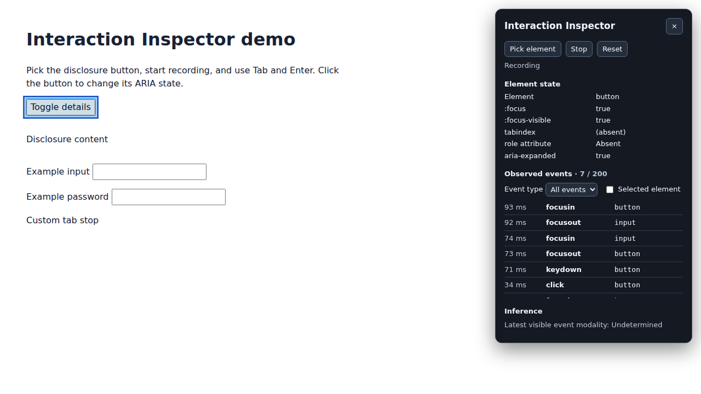

# Interaction Inspector

**English** · [한국어](docs/ko/README.md) · [日本語](docs/ja/README.md) · [简体中文](docs/zh-CN/README.md)

Interaction Inspector is a Chrome extension for understanding what happens between a user action and a UI change. It brings DOM events, keyboard focus, and selected ARIA state into one compact panel on the page you are debugging.

## The problem it solves

An interface can look correct while behaving differently for a mouse and a keyboard. When a disclosure opens but focus disappears, or `aria-expanded` does not match the visible state, the cause is often spread across DevTools panels and console output. Interaction Inspector keeps the relevant evidence together so the interaction can be reproduced and understood in context.

## What you can inspect

- Pick an element and keep it highlighted while reproducing an interaction.
- See live `:focus`, `:focus-visible`, tabindex category, and selected ARIA state tokens.
- Review the latest 200 trusted `focusin`, `focusout`, `click`, and `keydown` events in a readable timeline.
- Filter the timeline by event type or show only events targeting the selected element.
- Compare event activity with a separate, intentionally conservative input-modality inference.

## A typical use case

Select a disclosure button that works with a mouse but feels wrong with a keyboard. Reproduce the issue, then check which events fired, whether visible focus moved as expected, and whether the ARIA state changed with the UI. The result is a focused account of the interaction rather than a general-purpose page recording.

## Privacy by design

Interaction Inspector runs only after its toolbar icon is clicked. It uses `activeTab` and `scripting` without persistent host access, storage, network requests, or telemetry. Sessions remain in page memory and clear on navigation, panel close, or reset.

It records event types, not keyboard keys or codes. It does not read input values, passwords, page text, IDs, classes, or free-form ARIA values. Password-field events and keydowns from editable controls are excluded.

## Scope

The inspector covers the top-level document. Iframes, closed shadow roots, Chrome internal pages, and the Chrome Web Store are outside its inspection boundary. The project is intentionally narrow: it helps explain a single interaction without becoming a persistent analytics or recording system.

[Contributor guide](CONTRIBUTING.md) · [MIT License](LICENSE)
