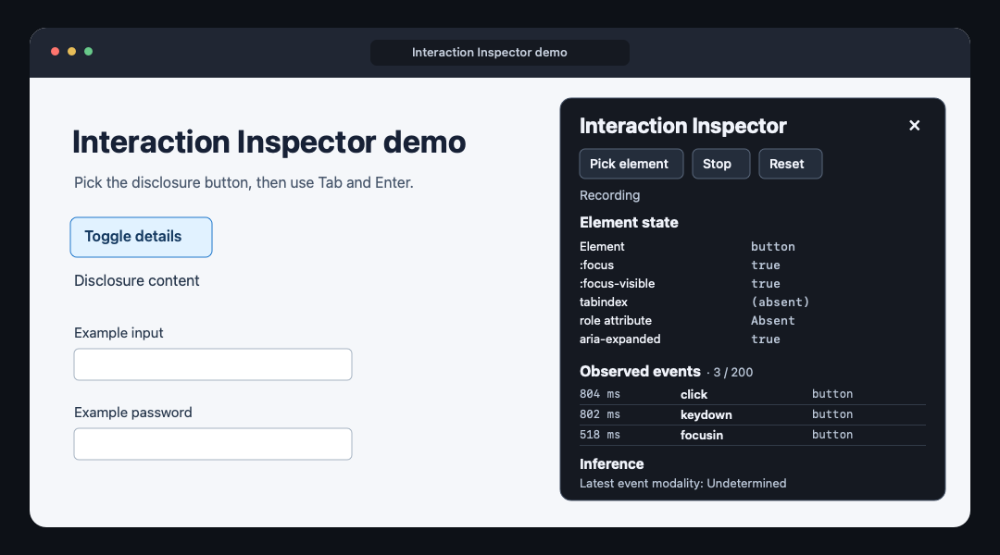

# Interaction Inspector

[English](../../README.md) · [한국어](../ko/README.md) · **日本語** · [简体中文](../zh-CN/README.md)

キーを押してから画面が変わるまでの動きを確認できます。Interaction Inspector は、デバッグ中のページ上で DOM イベント、キーボードフォーカス、ARIA の状態をまとめて表示する Chrome 拡張機能です。



*詳細を開閉するデモのイメージです。パネルに選択した要素の状態と操作中に記録したイベントが表示されます。*

## どんなときに使う？

マウスとキーボードで詳細ボタンの動きが異なるときは、ボタンを選択して操作を再現します。発生したイベント、フォーカス表示が維持されたかどうか、`aria-expanded` の変化を確認できます。

## 拡張機能を実行する

1. Node.js 24 以降をインストールし、`npm ci` と `npm run build` を実行します。
2. `chrome://extensions` で **デベロッパー モード**を有効にし、**パッケージ化されていない拡張機能を読み込む**から `dist/` を選択します。
3. `npm run demo` を実行し、Vite の URL に `/demo/` を付けて開きます。
4. ツールバーの拡張機能アイコンをクリックします。**Pick element** を選び、詳細を開閉するボタンをクリックすると、フォーカス、tabindex の区分、ARIA の状態を確認できます。Escape キーで要素選択をキャンセルします。
5. **Start** を選び、デモで Tab、Enter、マウスを使います。**Stop** は記録済みイベントを保持し、**Reset** は記録を停止して選択とタイムラインを消去します。**×** はパネルを閉じます。

## 確認できる項目

- 要素選択中にポインターを合わせた要素を強調表示し、選択後も強調を保持します。
- `:focus`、`:focus-visible`、宣言された tabindex の区分、対応する ARIA 状態値をリアルタイムで表示します。アクセシブルな名前に関わる属性と `role` は有無を表示します。
- ブラウザーが生成した信頼済みの `focusin`、`focusout`、`click`、`keydown` を新しい順に最大 200 件表示します。各行にはセッション開始からの経過時間、イベントの種類、許可リストに基づく要素タグが含まれます。
- 入力手段の推定は別欄に表示します。`keydown` はキーボード操作を示します。クリックとフォーカスのイベントでは入力手段を未確定と表示します。

対象は最上位のドキュメントです。iframe や閉じたシャドウルート内部のイベントは対象外です。Chrome の内部ページや Chrome ウェブストアなど、スクリプト挿入が制限されているページではツールバーに × バッジが表示されます。

## プライバシーと権限

ツールバーをクリックすると、`activeTab` と `scripting` の権限を使ってアクティブなタブに検査機能を挿入します。サイトへの永続的なアクセス権限、永続ストレージ、ネットワークリクエスト、テレメトリーは使用しません。セッションはページのメモリ上に保持され、別のドキュメントへの移動、パネルの終了、リセットで消去されます。

イベントの種類を記録します。キーの値やコードは記録せず、入力値、パスワード、ページ内のテキスト、ID、クラス、自由記述の ARIA 値も読み取りません。パスワード欄のイベントと編集可能なコントロールの `keydown` は記録から除外します。要素選択をキャンセルする Escape キーもタイムラインには残りません。

## 開発と検証

```sh
npm test
npm run build
npx playwright install chromium
npm run test:e2e
```

単体テストは Node のテストランナーで実行します。Playwright のスモークテストはビルド済み MV3 拡張機能の一時コピーを使い、テストページへの挿入と開いたシャドウルート上での操作を確認します。別の Chromium テストは本番のマニフェストをそのまま使い、DevTools Protocol 経由で実際のツールバーアクションを実行します。

[Oddmash コントリビューションガイド](https://github.com/Oddmash/.github/blob/main/docs/ja/CONTRIBUTING.md) · [MIT ライセンス原文](../../LICENSE) · [日本語訳](LICENSE.md)
