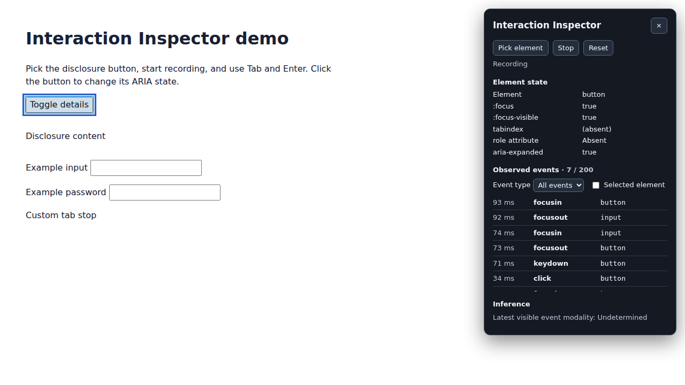

# Interaction Inspector

[English](../../README.md) · [한국어](../ko/README.md) · **日本語** · [简体中文](../zh-CN/README.md)

Interaction Inspector は、ユーザー操作から UI の変化までに何が起きたかを理解するための Chrome 拡張機能です。デバッグ中のページ上にある小さなパネルで、DOM イベント、キーボードフォーカス、選択した ARIA 状態をまとめて表示します。

## 解決する問題

見た目が正しくても、マウスとキーボードで挙動が異なることがあります。開閉領域は開くのにフォーカスが消える、または `aria-expanded` が表示状態と一致しない場合、手掛かりは複数の DevTools パネルやコンソールに分散しています。Interaction Inspector は必要な情報を一か所に集め、実際の文脈で操作を再現し理解できるようにします。

## 確認できること

- 要素を選択し、操作を再現している間もハイライトを維持します。
- `:focus`、`:focus-visible`、tabindex の分類、選択した ARIA 状態をリアルタイムで確認できます。
- 信頼済みの `focusin`、`focusout`、`click`、`keydown` イベントを最新 200 件までタイムラインで確認できます。
- イベント種別で絞り込み、または選択要素を対象とするイベントだけを表示できます。
- イベントの流れとは別に、断定を避けた入力モダリティ推論を比較できます。

## 代表的な利用場面

マウスでは動くもののキーボードでは不自然な開閉ボタンを選択します。問題を再現し、発生したイベント、可視フォーカスの移動、ARIA 状態と UI の同期を確認します。ページ全体を記録するのではなく、一つの操作を集中的に説明します。

## プライバシーを重視した設計

ツールバーアイコンをクリックした後だけ動作します。`activeTab` と `scripting` を使用し、常時のホスト権限、保存領域、ネットワーク通信、テレメトリは持ちません。セッションはページメモリ内にだけ保持され、移動、パネルを閉じる操作、リセットで消去されます。

記録するのはイベント種別だけで、キーやキーコードは記録しません。入力値、パスワード、ページ本文、ID、クラス、自由形式の ARIA 値を読み取りません。パスワード欄のイベントと編集可能なコントロールからの `keydown` も除外します。

## 対象範囲

トップレベル文書を対象とします。iframe、閉じた Shadow DOM、Chrome 内部ページ、Chrome ウェブストアは対象外です。永続的な分析や録画ではなく、一つのインタラクションを説明することに集中しています。

[コントリビューターガイド](../../CONTRIBUTING.md) · [MIT License](../../LICENSE)
