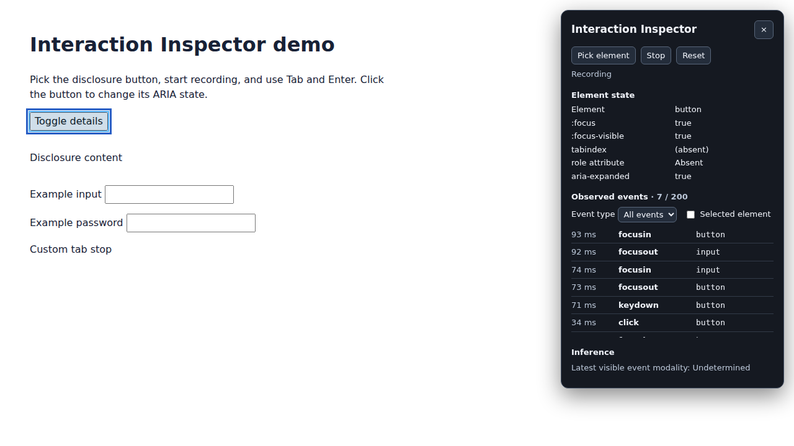

# Interaction Inspector

[English](../../README.md) · **한국어** · [日本語](../ja/README.md) · [简体中文](../zh-CN/README.md)

키를 누른 순간부터 화면이 바뀔 때까지 무슨 일이 일어났는지 확인하세요. Interaction Inspector는 디버깅 중인 페이지 위에서 DOM 이벤트, 키보드 포커스, ARIA 상태를 함께 보여주는 Chrome 확장 프로그램입니다.



*Chromium에서 확장 프로그램으로 상세 영역 데모를 검사하는 화면을 캡처했습니다.*

## 언제 쓰나요?

마우스로는 잘 열리는 상세 영역이 키보드에서는 다르게 동작할 때, 버튼을 선택하고 문제를 재현해 보세요. 어떤 이벤트가 발생했는지, 포커스 표시가 유지됐는지, `aria-expanded`가 바뀌었는지 확인할 수 있습니다.

## 확장 프로그램 실행

1. Node.js 24 이상을 설치하고 `npm ci`, `npm run build`를 실행합니다.
2. `chrome://extensions`에서 **개발자 모드**를 켜고 **압축해제된 확장 프로그램을 로드합니다**를 눌러 `dist/`를 선택합니다.
3. `npm run demo`를 실행한 뒤 Vite 주소에 `/demo/`를 붙여 엽니다.
4. 확장 프로그램 툴바 아이콘을 눌러 검사기를 엽니다. **Pick element**를 선택한 뒤 상세 정보를 펼치는 버튼을 클릭하면 포커스 상태, tabindex 범주, ARIA 상태를 확인할 수 있습니다. Escape를 누르면 요소 선택을 취소합니다.
5. **Start**를 누르고 데모에서 Tab, Enter, 마우스를 사용합니다. **Stop**은 기존 기록을 보존하고, **Reset**은 기록을 멈추고 선택과 타임라인을 지웁니다. **×**는 검사기를 닫습니다.

## 검사 항목

- 요소 위로 포인터를 옮기면 강조 표시되며, 선택한 요소는 강조 표시가 유지됩니다.
- 실시간 `:focus`, `:focus-visible`, 선언된 tabindex 범주와 지원하는 ARIA 상태 값을 확인합니다. 접근성 이름 관련 속성과 `role`은 존재 여부를 표시합니다.
- 브라우저에서 발생한 신뢰된 `focusin`, `focusout`, `click`, `keydown` 이벤트를 최신순으로 최대 200개 표시합니다. 각 행에는 세션 경과 시간, 이벤트 유형, 허용 목록에 따른 요소 태그가 표시됩니다.
- 이벤트 유형으로 타임라인을 필터링하거나 선택한 요소를 대상으로 발생한 이벤트만 볼 수 있습니다. 요소 구분에는 메모리의 임시 식별자를 사용합니다.
- 입력 방식 추론은 별도 영역에 표시합니다. `keydown`은 키보드 상호작용으로 표시하며, 클릭과 포커스 이벤트의 입력 방식은 미확정으로 표시합니다.

최상위 문서를 검사합니다. iframe과 닫힌 섀도 루트 내부의 이벤트는 검사 범위에서 제외됩니다. Chrome 내부 페이지와 Chrome 웹 스토어 등 스크립트 삽입이 제한된 페이지에서는 툴바에 × 배지가 표시됩니다.

## 개인정보 및 권한

툴바 클릭 시 `activeTab`과 `scripting` 권한으로 활성 탭에 검사기를 삽입합니다. 상시 사이트 접근 권한, 영구 저장소, 네트워크 요청, 텔레메트리는 사용하지 않습니다. 세션은 페이지 메모리에 유지되며 문서 이동, 패널 닫기, 초기화 시 지워집니다.

이벤트 유형만 기록하며 키 값과 키 코드는 기록하지 않습니다. 입력값, 비밀번호 값, 페이지 텍스트, ID, 클래스, 자유 형식 ARIA 값은 읽지 않습니다. 비밀번호 필드의 이벤트와 편집 가능한 컨트롤에서 발생한 `keydown`은 기록에서 제외합니다. 요소 선택을 취소하는 Escape 키도 타임라인에 기록되지 않습니다.

## 개발 및 검증

```sh
npm test
npm run build
npx playwright install chromium
npm run test:e2e
```

단위 테스트는 Node 테스트 러너로 실행합니다. Playwright 스모크 테스트는 빌드된 MV3 확장의 임시 복사본을 사용해 테스트 페이지에 스크립트를 삽입하고 열린 섀도 루트에서 동작을 확인합니다. 별도 Chromium 테스트는 프로덕션 매니페스트를 그대로 사용해 DevTools Protocol로 실제 툴바 액션을 실행합니다.

[Oddmash 기여 가이드](https://github.com/Oddmash/.github/blob/main/docs/ko/CONTRIBUTING.md) · [MIT 라이선스 원문](../../LICENSE) · [한국어 번역](LICENSE.md)
