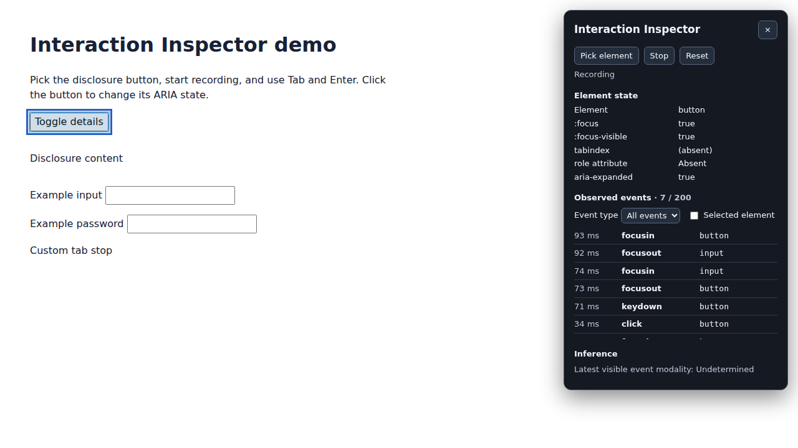

# Interaction Inspector

[English](../../README.md) · **한국어** · [日本語](../ja/README.md) · [简体中文](../zh-CN/README.md)

Interaction Inspector는 사용자 조작과 화면 변화 사이에서 어떤 일이 일어나는지 이해하도록 돕는 Chrome 확장 프로그램입니다. 디버깅 중인 페이지 위의 작은 패널에서 DOM 이벤트, 키보드 포커스, 선택한 ARIA 상태를 함께 보여 줍니다.

## 어떤 문제를 해결하나요?

인터페이스가 겉으로는 정상이어도 마우스와 키보드에서 다르게 동작할 수 있습니다. 상세 영역은 열리지만 포커스가 사라지거나 `aria-expanded`가 화면 상태와 맞지 않을 때, 원인은 여러 DevTools 패널과 콘솔 출력에 흩어져 있습니다. Interaction Inspector는 필요한 증거를 한곳에 모아 실제 맥락에서 문제를 재현하고 이해할 수 있게 합니다.

## 무엇을 확인할 수 있나요?

- 요소를 선택하고 상호작용을 재현하는 동안 강조 표시를 유지합니다.
- 실시간 `:focus`, `:focus-visible`, tabindex 범주, 선택한 ARIA 상태 값을 확인합니다.
- 신뢰된 `focusin`, `focusout`, `click`, `keydown` 이벤트를 최신 200개까지 읽기 쉬운 타임라인으로 봅니다.
- 이벤트 유형으로 필터링하거나 선택한 요소에서 발생한 이벤트만 표시합니다.
- 이벤트 흐름과 별도로, 과도하게 단정하지 않는 입력 방식 추론을 비교합니다.

## 대표적인 사용 장면

마우스로는 잘 열리지만 키보드에서는 어색한 상세 영역 버튼을 선택합니다. 문제를 재현한 다음 어떤 이벤트가 발생했는지, 보이는 포커스가 예상대로 이동했는지, ARIA 상태가 화면과 함께 바뀌었는지 확인합니다. 페이지 전체를 기록하는 대신 하나의 상호작용을 집중해서 설명합니다.

## 개인정보를 우선한 설계

툴바 아이콘을 클릭한 뒤에만 동작합니다. `activeTab`과 `scripting`을 사용하며 상시 사이트 접근 권한, 저장소, 네트워크 요청, 텔레메트리는 사용하지 않습니다. 세션은 페이지 메모리에만 남고 문서 이동, 패널 닫기, 초기화 시 지워집니다.

이벤트 유형만 기록하고 키 값이나 키 코드는 기록하지 않습니다. 입력값, 비밀번호, 페이지 텍스트, ID, 클래스, 자유 형식 ARIA 값을 읽지 않으며 비밀번호 필드의 이벤트와 편집 가능한 컨트롤의 `keydown`도 제외합니다.

## 검사 범위

최상위 문서를 검사합니다. iframe, 닫힌 섀도 루트, Chrome 내부 페이지, Chrome 웹 스토어는 검사 범위 밖입니다. 지속적인 분석이나 녹화 시스템이 아니라 하나의 상호작용을 설명하는 데 집중합니다.

[기여 안내](../../CONTRIBUTING.md) · [MIT 라이선스](../../LICENSE)
