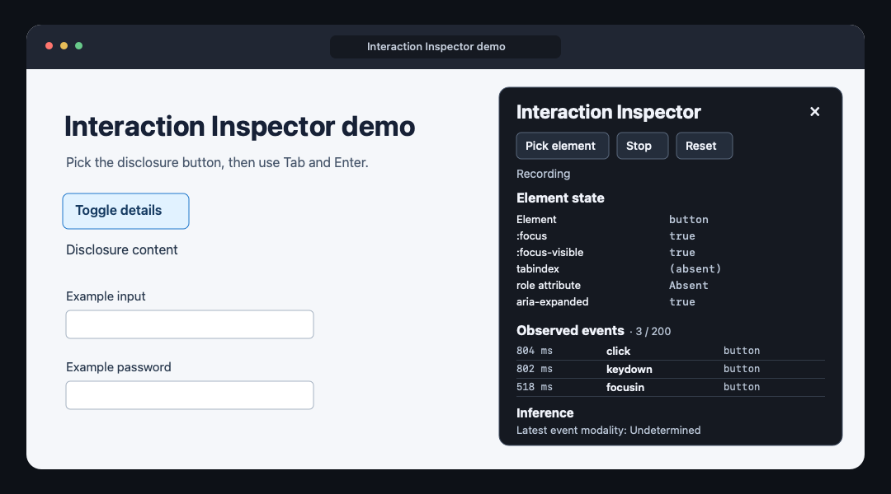

# Interaction Inspector

[English](../../README.md) · [한국어](../ko/README.md) · [日本語](../ja/README.md) · **简体中文**

查看从按下按键到界面变化之间发生了什么。Interaction Inspector 是一款 Chrome 扩展，可在正在调试的页面上同时显示 DOM 事件、键盘焦点和 ARIA 状态。



*展开详情演示的示意图。面板显示选中元素的状态，以及操作期间记录的事件。*

## 什么时候用？

如果用鼠标和键盘操作展开按钮时表现不同，选中该按钮并复现问题。你可以查看触发了哪些事件、焦点指示是否仍然可见，以及 `aria-expanded` 是否发生变化。

## 运行扩展

1. 安装 Node.js 24 或更高版本，然后运行 `npm ci` 和 `npm run build`。
2. 在 `chrome://extensions` 中启用**开发者模式**，点击**加载已解压的扩展程序**并选择 `dist/`。
3. 运行 `npm run demo`，在 Vite 提供的网址后加上 `/demo/` 并打开。
4. 点击工具栏中的扩展图标打开检查器。选择 **Pick element**，再点击展开详情的按钮，即可查看焦点状态、tabindex 类别和 ARIA 状态。按 Escape 取消选择。
5. 点击 **Start**，然后在演示页面使用 Tab、Enter 和鼠标。**Stop** 会保留已记录的事件，**Reset** 会停止记录并清除所选元素和时间线，**×** 会关闭检查器。

## 检查内容

- 选择元素时高亮鼠标悬停的元素，选中后保留高亮。
- 实时查看 `:focus`、`:focus-visible`、声明的 tabindex 类别和受支持的 ARIA 状态值。无障碍名称相关属性及 `role` 只显示是否存在。
- 按时间倒序查看最近 200 条由浏览器产生的可信 `focusin`、`focusout`、`click` 和 `keydown` 事件。每条记录包括会话经过时间、事件类型及允许列表中的元素标签。
- 输入方式推断单独显示。`keydown` 表示键盘操作，点击与焦点事件的输入方式显示为未确定。

检查范围为顶层文档。iframe 和封闭 Shadow Root 内部的事件不在检查范围内。Chrome 内部页面及 Chrome 应用商店等页面限制脚本注入，工具栏图标会显示 × 标记。

## 隐私和权限

点击工具栏图标后，扩展使用 `activeTab` 和 `scripting` 权限向当前标签页注入检查器。扩展不使用持久的网站访问权限、持久存储、网络请求或遥测。会话只保存在页面内存中，文档导航、关闭面板或重置时会清除。

扩展记录事件类型，不记录键值或键码，也不读取输入值、密码、页面文字、ID、类名或任意文本形式的 ARIA 值。密码字段中的事件和可编辑控件中的 `keydown` 会被过滤。用于取消元素选择的 Escape 键也不会写入时间线。

## 开发与验证

```sh
npm test
npm run build
npx playwright install chromium
npm run test:e2e
```

单元测试使用 Node 测试运行器。Playwright 冒烟测试通过构建后 MV3 扩展的临时副本，在测试页面注入脚本并通过开放的 Shadow Root 验证交互。另一个 Chromium 测试使用原样的生产清单，通过 DevTools Protocol 触发实际的工具栏操作。

[Oddmash 贡献指南](https://github.com/Oddmash/.github/blob/main/docs/zh-CN/CONTRIBUTING.md) · [MIT 许可证原文](../../LICENSE) · [简体中文译文](LICENSE.md)
