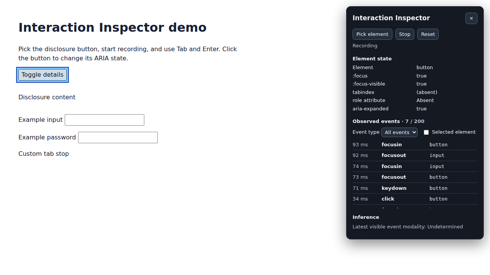

# Interaction Inspector

[English](../../README.md) · [한국어](../ko/README.md) · [日本語](../ja/README.md) · **简体中文**

Interaction Inspector 是一款 Chrome 扩展，用于理解从用户操作到界面变化之间发生了什么。它在正在调试的页面上用一个紧凑面板集中显示 DOM 事件、键盘焦点和选定的 ARIA 状态。

## 它解决什么问题

界面看起来正常时，鼠标和键盘的行为仍可能不同。折叠区域已经打开但焦点消失，或 `aria-expanded` 与可见状态不一致时，线索往往分散在多个 DevTools 面板和控制台输出中。Interaction Inspector 把相关证据放在一起，让你能在真实上下文中复现并理解交互。

## 可以检查什么

- 选择一个元素，并在复现交互时持续高亮它。
- 实时查看 `:focus`、`:focus-visible`、tabindex 分类和选定的 ARIA 状态。
- 在清晰的时间线中查看最近 200 个可信的 `focusin`、`focusout`、`click` 和 `keydown` 事件。
- 按事件类型筛选，或只显示目标为所选元素的事件。
- 将事件活动与独立且谨慎的输入方式推断进行比较。

## 典型使用场景

选择一个鼠标操作正常、键盘操作却不自然的折叠按钮。复现问题后，查看触发了哪些事件、可见焦点是否按预期移动，以及 ARIA 状态是否与界面同步变化。它专注解释一次交互，而不是记录整个页面。

## 隐私优先的设计

只有点击工具栏图标后才会运行。扩展使用 `activeTab` 和 `scripting`，没有持久站点访问权限、存储、网络请求或遥测。会话只保留在页面内存中，并在导航、关闭面板或重置时清除。

它只记录事件类型，不记录按键或键码，也不读取输入值、密码、页面文本、ID、类名或自由形式的 ARIA 值。密码字段上的事件和可编辑控件中的 `keydown` 也会被排除。

## 检查范围

检查器只覆盖顶层文档。iframe、封闭的 Shadow DOM、Chrome 内部页面和 Chrome 网上应用店不在范围内。它刻意保持专注，用来解释一次交互，而不是成为持续分析或录制系统。

[贡献指南](../../CONTRIBUTING.md) · [MIT License](../../LICENSE)
